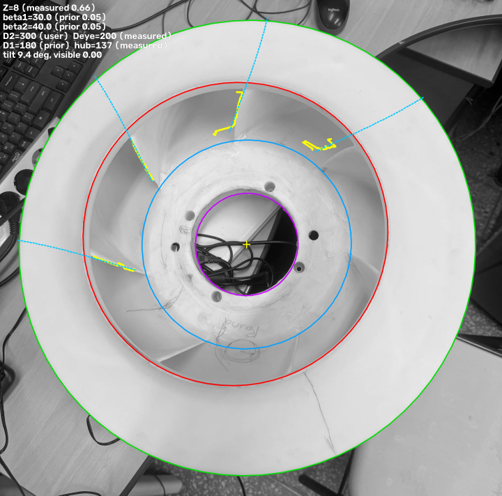

# fanscan — 원심 팬 임펠러 사진 → 형상 파라미터 → STEP

원심 팬 임펠러 사진에서 주요 형상 파라미터를 추출하고, 그 파라미터로 CAD 솔리드(STEP)를 생성하는 파이프라인입니다.
두 가지 모드가 있습니다.

| 모드 | 대상 | 입력 사진 | 상태 |
|---|---|---|---|
| **open** (v0.1) | 후판 위에 블레이드가 노출된 개방형 임펠러 | 축방향 정면 1장 + 흰 기준 원판 | 합성 검증 완료, 오차 ≤ 1.6 % / 0.6° |
| **shrouded** (v0.2) | 전면 슈라우드가 붙은 밀폐형(양산형) 임펠러 | 입구 구멍을 보는 정면 1장 (+ 테두리 측면 사진) | 합성 검증 완료, **실물은 Z·지름만 안정** |

```
사진  ──analyze──▶  params.json (값마다 출처·신뢰도)  ──build──▶  impeller.step
                         ▲
   synth / render (정답을 아는 합성 사진) ┘
```

## 추출하는 파라미터와 출처

모든 값에는 **출처(provenance)** 와 **신뢰도 0–1** 이 붙습니다. 출처는 다섯 가지입니다.

| 출처 | 의미 |
|---|---|
| `user` | 사용자가 입력 (`--outer-diameter-mm` 등) |
| `measured` | 사진에서 직접 측정 |
| `extrapolated` | 보이는 구간의 블레이드 곡선을 모델로 D₂까지 외삽 (β₂) |
| `wrap` | 앞전·뒷전 방위각 차(감김각)로 역산 (β₂, 측면 사진 필요) |
| `prior` | **측정 불가 → 설계 관례 사전값.** 신뢰도 ≤ 0.15. 이 값은 "모름"이라는 뜻입니다 |

| 파라미터 | open 모드 | shrouded 모드 |
|---|---|---|
| 외경 D₂ | 측정 | 테두리 타원에서 측정, 또는 입력 |
| 입구경 D_eye / 앞전경 D₁ | 측정 | 입구 링 측정 / 앞전은 대개 안 보여 prior |
| 허브경, 보어경 | 측정 | 측정 (보어 타원이 축 기준) |
| 블레이드 수 Z | 측정 | 측정 (극좌표 주기성) |
| 입구각 β₁ | 측정 | 뿌리 궤적이 충분히 일치할 때만 측정, 아니면 prior |
| 출구각 β₂ | 측정 | 외삽, 또는 측면 사진+마커로 wrap |
| 블레이드 두께 t | 측정 (±15 %) | prior |
| 블레이드 폭 b | 입력 | 입력, 또는 측면 사진에서 측정, 아니면 prior |

블레이드 캠버선은 **β가 반경에 선형으로 변하는 모델**(`fanscan/geometry.py`)로 정의되고, 합성·분석·CAD가 같은 모델을
공유하므로 왕복 검증이 성립합니다. β₂ < 85° 후향, 85–95° 방사형, > 95° 전향.

## 설치

```bash
python3 -m venv .venv && . .venv/bin/activate
pip install -e ".[dev]"
```

## 사용법

### 밀폐형 임펠러 (shrouded, v0.2)

```bash
# 정면(입구 구멍) 사진 분석. D2와 입구경을 알면 둘 다 주세요 — 둘 다 있어야 원근 보정이 됩니다.
python -m fanscan.cli analyze photo.jpg --mode shrouded \
    --outer-diameter-mm 300 --eye-diameter-mm 200 --blade-width-mm 55 \
    --out out/params.json --overlay out/overlay.png

# 측면(테두리 틈새) 사진을 추가하면 β2를 감김각으로 구합니다. 슈라우드 테두리에 밝은 테이프 마커가
# 정면·측면 사진 모두에 보여야 합니다.
python -m fanscan.cli analyze photo.jpg --mode shrouded --outer-diameter-mm 300 --eye-diameter-mm 200 \
    --rim-image side1.jpg --rim-image side2.jpg --rim-image side3.jpg --marker bright \
    --out out/params.json --overlay out/overlay.png

# 아무 치수도 모를 때: D2 := 300 mm 사전값으로 비율만 보고합니다 (출처 prior, 신뢰도 0.05)
python -m fanscan.cli analyze photo.jpg --mode shrouded --out out/params.json

# 파라미터 → STEP (+ STL)
python -m fanscan.cli build out/params.json --out out/impeller.step --stl out/impeller.stl
```

### 개방형 임펠러 (open, v0.1)

```bash
python -m fanscan.cli analyze photo.png --mode open --ref-diameter-mm 30 --blade-width-mm 40 \
    --out out/params.json --overlay out/overlay.png
```

### 합성 검증

```bash
# v0.1: 2-D 합성 사진 → 분석 → STEP, 오차표 (허용치 초과 시 exit 1)
python -m fanscan.cli pipeline --out-dir out/pipe --noise 8 --blur 1.5 --rotation 13

# v0.2: 3-D 렌더(카메라 프리셋·잡동사니 배경) → 슈라우드 분석 → STEP, 오차표
python -m fanscan.cli pipeline3d --out-dir out/p3d --preset axial_close --clutter
python -m fanscan.cli render --preset tilt --tilt-deg 15 --clutter --out out/r.png
```

프리셋: `axial_far` `axial_close` `tilt` `oblique` `side`.

## 실물 사진으로 지금 되는 것 / 안 되는 것

`samples/real_axial_eye.jpg` (양산형 밀폐 임펠러, 폰으로 가까이서 기울여 찍음, 책상 잡동사니 배경, 치수 모름):



| 항목 | 결과 | 출처 | 신뢰도 |
|---|---|---|---|
| 블레이드 수 | **8** | measured | 0.66 |
| 입구경 / D₂ | 0.667 | measured | 0.5 |
| 허브경 / D₂ | 0.458 | measured | 0.32 |
| 보어경 / D₂ | 0.224 | measured | 0.6 |
| 회전 방향 | 시계 방향 스윕 | measured | — |
| β₁, β₂ | 30°, 40° | **prior** | 0.05 |

**β는 이 사진에서 못 구합니다.** 추적되는 블레이드 뿌리 궤적들이 서로 맞지 않고(세 블레이드에서 46°/87°/83°), 가시 구간이
반경의 1/3뿐이며, 카메라가 가까워 시차가 큽니다. 분석기는 이 경우 자신 있는 숫자 대신 `prior`를 내고 경고를 띄웁니다.
이 판정은 사진을 90°/180°/270° 회전, 좌우 반전, 900 px 축소, 감마 0.8/1.2로 바꿔도 동일합니다 (`tests/test_shrouded_regressions.py`).

실물에서 β₂까지 얻으려면 (합성 검증 기준 ±3°):
1. 슈라우드 테두리에 **밝은 테이프 마커** 하나를 붙입니다.
2. **정면** 1장: 1.5 m 이상 떨어져 망원으로, 수직 하향, 입구 링과 테두리가 동심원으로 보이게.
3. **측면** 2–3장: 테두리 틈새(슈라우드와 후판 사이)가 보이도록 축에 수직하게, 마커가 보이는 방위에서.
4. 줄자로 **외경, 입구 구멍 지름, 블레이드 폭** 세 개를 재서 입력합니다.

## 검증 결과 (합성, 정답 있음)

`pytest` 369개 통과 (렌더 캐시 콜드 ~8 min, 웜 ~5 min).

- **open**: 128 케이스 격자 (Z 6–16 × β₂ 30–90° × 노이즈 × 블러 × 회전) 최악 오차 D 1.6 %, β 0.6°, Z 전부 정확.
  회귀 33 케이스 (두꺼운 블레이드, 1 px/mm 저해상도, Z=2~32, 긴 블레이드, 16-bit/float 입력).
- **shrouded**: 27 케이스 격자 (axial_far/close/tilt10 × Z 9/11/13 × β₂ 30/40/55, D₂+입구경 입력) Z 27/27,
  β₁ ≤ 1.4°, β₂ 외삽 중앙값 1–3° (근거리 최악 8°). 잡동사니 배경 9 케이스 중 8 측정·정확, 1은 prior.
  감김각 β₂ (측면 3장 + 마커) 3 케이스 모두 ±3° 이내. 회귀 39 케이스 (축 고정, β 게이트, 회전 방향 안정성,
  블레이드 없는 사진, 입력 검증).

## 한계

- 실물 사진 검증은 치수를 모르는 1개 샘플뿐 — 정답을 아는 실물 검증이 없습니다.
- shrouded 모드에서 D₂ 하나만 주면 원근 보정이 안 되어 근거리 촬영 시 입구경이 +6~13 % 과대 (경고 출력). 입구경도 같이 주세요.
- 기울기 20° 이상, 강한 잡동사니에서는 Z 검출이 떨어집니다 (prior로 보고).
- 블레이드 폭·두께·슈라우드 곡률은 정면 사진에서 못 뽑습니다.
- STEP 블레이드는 128분할 폴리라인 면 (파일 4–7 MB).

## 구조

```
fanscan/params.py       ImpellerParams (슈라우드·보어·테이퍼 필드 포함), JSON, 비교
fanscan/geometry.py     블레이드 캠버선 모델, 역산 피팅, 감김각 ↔ β2 솔버
fanscan/synth.py        v0.1 2-D 합성 사진
fanscan/analyze.py      v0.1 개방형 분석기
fanscan/cad.py          CadQuery 솔리드 (개방형 / 원추 슈라우드+입구 링+보어), 메시, STEP/STL
fanscan/render3d.py     의존성 없는 z-버퍼 렌더러, 카메라 프리셋, 잡동사니 배경, 마커
fanscan/pose.py         테두리·입구 링 타원 검출, 기울기 보정, 원근 스케일
fanscan/shrouded.py     v0.2 밀폐형 분석기 (출처·신뢰도 포함)
fanscan/cli.py          synth / analyze / build / pipeline / render / pipeline3d
tests/                  369 tests
SPEC.md, SPEC2.md       모듈 계약 (v0.1, v0.2)
```
