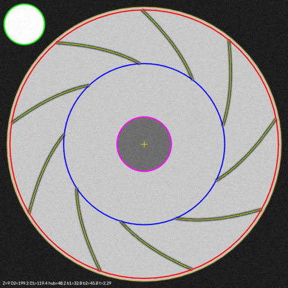

# fanscan — 원심 팬 임펠러 사진 → 형상 파라미터 → STEP

축방향(정면)에서 찍은 원심 팬 임펠러 사진 한 장으로 주요 형상 파라미터를 추출하고,
그 파라미터로 CAD 솔리드(STEP)를 생성하는 파이프라인입니다.

```
사진 (axial view)  ──analyze──▶  params.json  ──build──▶  impeller.step
                                      ▲
            synth (테스트용 합성 사진 + 정답) ┘
```



*노이즈·블러·회전이 들어간 합성 사진에 대한 분석 오버레이. 빨강 = D₂, 파랑 = D₁, 자홍 = 허브, 노랑 = 추적된 블레이드 캠버선.*

## 추출하는 파라미터

| 파라미터 | 기호 | 사진에서 관측 가능? |
|---|---|---|
| 외경 / 입구경 / 허브경 | D₂ / D₁ / D_hub | ✅ |
| 블레이드 개수 | Z | ✅ |
| 입구 / 출구 블레이드 각 (접선 기준) | β₁ / β₂ | ✅ |
| 블레이드 두께 | t | ✅ (근사, ±15 %) |
| 블레이드 폭 (축방향) | b | ❌ 축방향 사진에선 안 보임 → `--blade-width-mm`로 지정 |

블레이드 캠버선은 **β가 반경에 선형으로 변하는 모델**(`fanscan/geometry.py`)로 정의되고, 합성·분석·CAD 세 모듈이
같은 모델을 공유하므로 왕복 검증이 성립합니다. β₂ < 85° 후향, 85–95° 방사형, > 95° 전향으로 분류합니다.

## 설치

```bash
python3 -m venv .venv && . .venv/bin/activate
pip install -e ".[dev]"
```

## 사용법

```bash
# 1) 테스트용 합성 사진 생성 (정답 JSON도 함께 저장)
python -m fanscan.cli synth --out out/synth.png --noise 8 --blur 1.5 --rotation 13

# 2) 사진 분석 → 파라미터 JSON (+ 오버레이)
python -m fanscan.cli analyze out/synth.png --ref-diameter-mm 30 --blade-width-mm 40 \
    --out out/params.json --overlay out/overlay.png

# 3) 파라미터 → STEP (+ STL)
python -m fanscan.cli build out/params.json --out out/impeller.step --stl out/impeller.stl

# 한 번에: synth → analyze → build + 오차표 (허용치 초과 시 exit 1)
python -m fanscan.cli pipeline --out-dir out/pipe --noise 8 --blur 1.5 --rotation 13 --stl
```

스케일 기준은 둘 중 하나를 반드시 줘야 합니다:
- `--ref-diameter-mm X`: 사진 안에 지름 X mm의 **흰색 원판**(기준물)이 임펠러 밖에 찍혀 있을 때
- `--outer-diameter-mm X`: 임펠러 외경을 이미 알고 있을 때

## 실제 팬을 찍을 때

v0.1 분석기는 합성 이미지 규약에 맞춰져 있습니다. 실물 사진은 아래 조건에 가까울수록 잘 됩니다.

1. **축방향 정면 촬영** — 렌즈가 회전축과 일치하도록. 기울어지면 원이 타원이 되어 D가 틀어집니다.
2. **슈라우드 제거 또는 입구 쪽에서 촬영** — 블레이드가 허브와 외경 사이에서 보여야 합니다.
3. **밝은 후판, 어두운 블레이드** — 대비가 반대면 이미지를 반전해서 넣으세요 (`cv2.bitwise_not`).
4. **기준물** — 지름을 아는 흰 원판(동전·와셔에 흰 종이)을 임펠러 **밖** 평면에 같이 두세요.
5. 균일 조명, 삼각대, 어두운 배경.

## 검증 결과

`pytest` 149개 통과(약 30 s). 분석기 격자 테스트 128 케이스
(Z ∈ {6, 9, 12, 16} × β₂ ∈ {30, 45, 60, 90} × 노이즈 {0, 8} × 블러 {0, 1.5 px} × 회전 {0°, 13°})
최악 오차: D₂ 1.2 %, D₁ 1.6 %, 허브 0.5 %, β₁ 0.6°, β₂ 0.2°, Z 전부 정확.
두께는 렌더러 안티앨리어싱 때문에 일관되게 +15 % (합성 이미지 쪽 아티팩트).

## 한계 (v0.1)

- 합성 이미지로만 검증됨 — 실물 사진 검증 필요.
- 원근·기울기 보정 없음, 슈라우드 있는 임펠러 미지원.
- 블레이드 폭 b, 후판 두께, 슈라우드 곡률은 사진에서 못 뽑음 → 수동 입력.
- STEP의 블레이드는 128분할 폴리라인 면 (파일 ~4.6 MB). 스플라인 면으로 바꾸면 50배 작아짐.

## 구조

```
fanscan/params.py    ImpellerParams 데이터클래스, JSON, 비교
fanscan/geometry.py  블레이드 캠버선 모델 (정방향 + 역산 피팅)
fanscan/synth.py     합성 사진 렌더러 (정답 포함)
fanscan/analyze.py   OpenCV 분석기: 스케일, 원 검출, 극좌표 변환, FFT 블레이드 계수, 캠버 추적
fanscan/cad.py       CadQuery 솔리드 → STEP / STL
fanscan/cli.py       synth / analyze / build / pipeline
tests/               149 tests
SPEC.md              모듈 계약
```
